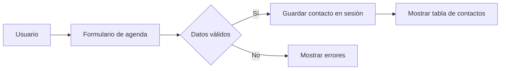

# Práctica 1: Introducción a PHP

Ejercicios de introducción a PHP para 2.º DAW. Incluye variables, condicionales,
arrays, formularios, sesiones y una mini agenda de contactos.

## Ejercicios

| Archivo | Contenido |
|:--|:--|
| `presentacion.php` | Variables y salida de texto |
| `tabla.php` | Formulario y tabla de multiplicar |
| `alumnos.php` | Arrays, funciones y promedio |
| `registro.html`, `procesar.php` | Formulario y validación |
| `bienvenida.php`, `logout.php` | Sesión de usuario |
| `agenda.php` | Mini agenda guardada en sesión |

## Requisitos y ejecución

- PHP 8.0 o superior.
- Un servidor web local con soporte PHP.

Coloca el proyecto en el directorio público del servidor y abre en el navegador
`presentacion.php`, `tabla.php`, `alumnos.php`, `registro.html` o `agenda.php`.
Los archivos PHP deben ejecutarse desde un servidor local; no basta con abrirlos
directamente desde el explorador de archivos.

## Imagen del proyecto

Guarda una imagen en el directorio `images/` y enlázala así:

## Tareas pendientes

- [x] Completar los ejercicios de variables, tablas y notas.
- [x] Añadir registro con validación y sesión.
- [x] Crear la agenda de contactos.
- [ ] Añadir persistencia de contactos en una base de datos.

> [!NOTE]
> Los contactos de la agenda se guardan en la sesión y desaparecen al terminarla.

> [!WARNING]
> No introduzcas datos personales reales en esta aplicación de demostración.

## Preguntas frecuentes

¿Por qué no funciona al abrir un archivo PHP directamente?

Los archivos PHP necesitan ejecutarse en un servidor con PHP habilitado.

¿Dónde se almacenan los contactos?

En la sesión del navegador. El proyecto todavía no usa una base de datos.

## Flujo de la agenda

## Registro de cambios

Consulta el [CHANGELOG.md](CHANGELOG.md) para ver las versiones y modificaciones.

## Colaboración y licencia

Consulta [CONTRIBUTING.md](CONTRIBUTING.md) para proponer cambios.

Este proyecto utiliza la licencia MIT porque permite estudiar, modificar y
reutilizar el código, manteniendo el aviso de copyright. El texto completo está
en [LICENSE](LICENSE).

## Autoría

Nombre Apellido — 2.º DAW.

[^1]: Práctica educativa de introducción a PHP.
