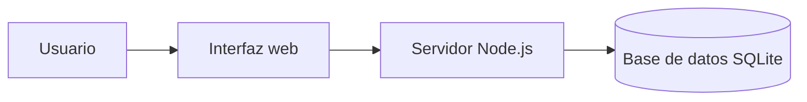

# TaskFlow


Aplicación web sencilla para organizar tareas y proyectos.


## Características

- Crear y editar tareas.
- Asignar prioridades y fechas límite.
- Marcar tareas como completadas.
- Consultar las tareas desde cualquier dispositivo.

## Tecnologías

| Parte | Tecnología |
|:--|:--|
| Interfaz | HTML, CSS y JavaScript |
| Servidor | Node.js |
| Datos | SQLite |

## Requisitos

- Node.js 20 o superior
- npm

## Instalación

```bash
git clone https://github.com/usuario/taskflow.git
cd taskflow
npm install
npm run dev
```

## Uso

1. Crea una cuenta.
2. Añade una tarea con su fecha límite.
3. Marca la tarea como completada cuando termines.

También puedes consultar el [registro de cambios](CHANGELOG.md).

## Tareas pendientes

- [x] Crear el diseño inicial.
- [x] Añadir creación y edición de tareas.
- [ ] Incorporar recordatorios por correo.
- [ ] Publicar la aplicación.

> [!NOTE]
> TaskFlow guarda las tareas en la base de datos local del servidor.

> [!WARNING]
> No compartas tus credenciales ni subas archivos con contraseñas al repositorio.

## Preguntas frecuentes

<details>
<summary>¿Cómo instalo la aplicación?</summary>

Sigue los pasos de la sección **Instalación**.

</details>

<details>
<summary>¿Puedo usar TaskFlow desde el móvil?</summary>

Sí. La interfaz se adapta a pantallas de distintos tamaños.

</details>

## Funcionamiento



## Licencia

Este proyecto usa la licencia MIT porque permite reutilizar y modificar el código,
manteniendo el aviso de copyright. Consulta el archivo [LICENSE](LICENSE).

## Autoría

Nombre Apellido — curso y centro educativo.

[^1]: TaskFlow es un proyecto educativo de demostración.
