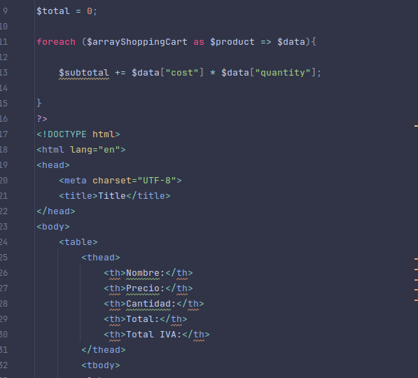
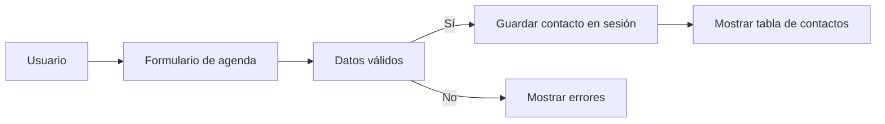

# Practica 1

Ejercicios primeros de php.

## Ejercicios

| Archivo                                   | Contenido                         |
| :---------------------------------------- | --------------------------------: |
| `presentacion.php`                        | Variables y salida de texto       |
| `tabla.php`                               | Formulario y tabla de multiplicar |
| `alumnos.php`                             | Arrays, funciones y promedio      |
| `registro.html`, `procesar.php`           | Formulario y validación           |
| `bienvenida.php`, `logout.php` (No hecho) | Sesión de usuario                 |
| `agenda.php`                              | Mini agenda guardada en sesión    |

## Requisitos y ejecución

- PHP 8.0
- Un servidor web con PHP.

Coloca el proyecto en el directorio del servidor y abre en el navegador
`presentacion.php`, `tabla.php`, `alumnos.php`, `registro.html` o `agenda.php`.
Los archivos se tienen que ejecutar desde un servidor no se puede abrir el archivo y ya esta.
## Imagen del proyecto

## Tareas pendientes

- [x] Completar los ejercicios de variables, tablas y notas.
- [x] Añadir registro con validación y sesión.
- [x] Crear la agenda de contactos.
- [ ] Hacer el ejercicio 5

> [!NOTE]
> Los contactos de la agenda se guardan en la sesión y desaparecen al terminarla.

> [!WARNING]
> No introduzcas datos personales reales en la aplicación

## Preguntas frecuentes

¿Por qué no funciona al abrir un archivo PHP directamente?

Los archivos PHP necesitan ejecutarse en un servidor con PHP.

¿Dónde se almacenan los contactos?

En el nevagador

## Mermaid de la agenda

## Registro de cambios

Mira el [CHANGELOG.md](CHANGELOG.md) para ver las versiones y modificaciones.

## Colaboración y licencia

Consulta [CONTRIBUTING.md](CONTRIBUTING.md) para proponer cambios.

Este proyecto utiliza la licencia MIT porque permite estudiar, modificar y
reutilizar el código, manteniendo el aviso de copyright. El texto completo está
en [LICENSE](LICENSE).

## Autoría

José María Gómez Vélez - 2DAW-m.

¹Notita de pie de paginita
